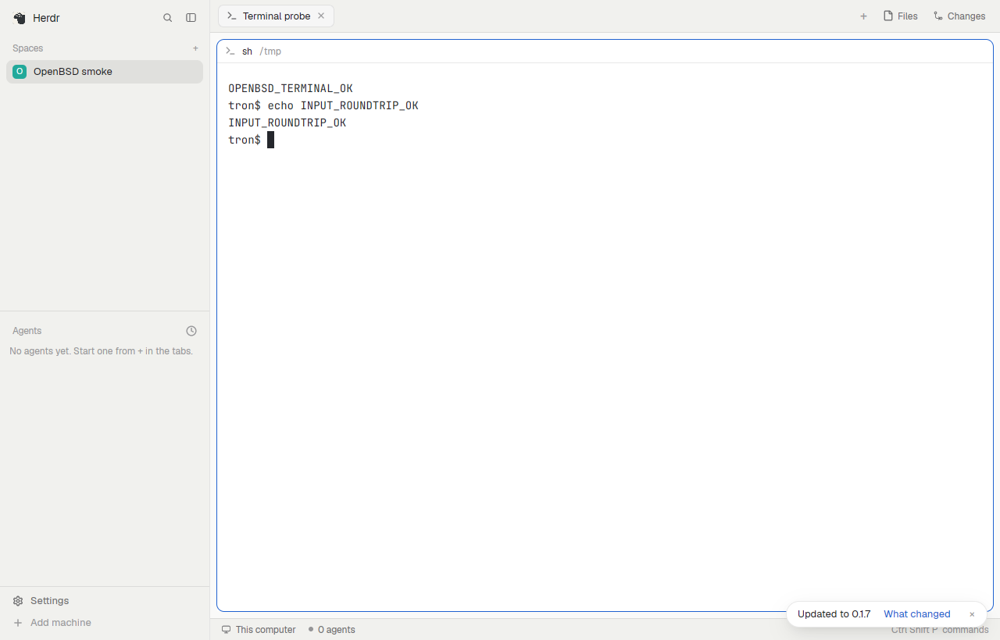

# OpenBSD desktop port

Native source build tested on OpenBSD 8.0 amd64, with Rust 1.99.1 and Zig
0.16.0. This branch extends the existing BSD/X11 GPUI path and enables the
Unix Vulkan backend in wgpu. The existing Herdr 0.9.x TUI remains separate.

## Build and run

Install Rust, rustfmt, LLVM/libclang, Zig 0.16, pkg-config, xkbcommon and Vulkan
loader/headers through OpenBSD packages. X11, fontconfig and FreeType are also
required. Clone with the pinned Ghostty submodule initialized.

```sh
scripts/build-openbsd
# Install a compatible native herdr-core separately; its version must be >= 0.1.11.
scripts/run-openbsd
```

Run from an X11 desktop session. `DISPLAY` must name that session. The launcher
adds Xenocara's `/usr/X11R6/share` to `XDG_DATA_DIRS` so the Vulkan loader finds
Mesa's ICD manifests. The build recipe uses the packaged rustfmt: a successful
formatter shim that writes no output otherwise causes bindgen to emit empty
bindings. No shell profile or global tool configuration is changed.

For a faster development build, the validated command was:

```sh
scripts/build-openbsd build --locked --config 'profile.dev.package."*".opt-level=0' --config profile.dev.debug=0
```

## Changes

- Ghostty VT maps the native OpenBSD Rust target to Zig's target.
- QuickJS generates bindings for OpenBSD from the same pinned headers. Its
  existing interpreter fallback is used; no executable-memory/JIT workaround
  or system security setting is added.
- Vendored GPUI platform/base/Linux crates include OpenBSD in the existing BSD
  paths; the portable priority queue and Wayland protocol types are available
  when their features are enabled. Headless frame capture is enabled too.
- Vendored wgpu, wgpu-core and their platform-feature helper enable the Vulkan
  backend on OpenBSD, preserving other OS conditions. The application links
  against the normal `/usr/local/lib` package directory.
- Process working directories come from `KERN_PROC_CWD`, with the existing
  change-directory and missing-process tests enabled on OpenBSD. Terminal copy
  also updates the X11 primary selection.

## Validation

`cargo check` and native `cargo build` passed. `cargo test` passed, including
162 unit tests, CLI/manual checks and production pixel-capture tests.
`git diff --check` and shell syntax checks passed.

The runtime probe used a private Xvfb display, `HERDR_APP_HOME`, `HC_SESSION`
and XDG paths. The actual window rendered. A new space and terminal displayed
`OPENBSD_TERMINAL_OK`; a sent shell command returned `INPUT_ROUNDTRIP_OK`.
`status.errors` was empty. The screenshot was inspected, and the private app,
core and display were stopped afterwards.



Xvfb reports no physical mouse/DRI3; the desktop portal is absent in the sandbox,
and the app uses its existing filesystem polling fallback for a socket. These
are sandbox diagnostics, not successful checks of physical input, desktop
portals or native Xorg presentation. Wayland was compiled but not runtime
tested. Other operating systems were not tested locally.

The accompanying separate herdr-core port passes 82 unit tests (one ignored),
foreground/run/keep integration tests, and eight of nine exec tests. Its stalled
reader/backpressure integration test remains unresolved; see that fork's PR.

## Initial failures reproduced

The unmodified upstream source first failed on missing QuickJS bindings for
`x86_64-unknown-openbsd`. Enabling binding generation exposed the local rustfmt
shim. After using real rustfmt, the next failures were the Ghostty target
mapping and GPUI platform gates. The first executable then exposed wgpu's
missing backend target gates. These were repaired and the native runtime probe
above was executed.
