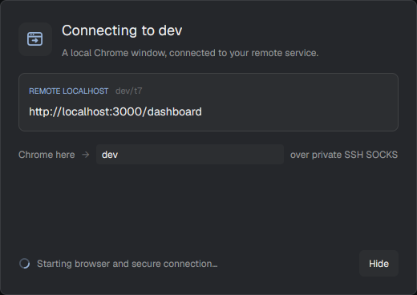

# Remote loopback browser personal mod

An opt-in GPUI mod that opens remote terminal localhost links in **local Chrome through SSH SOCKS5**. Chrome and the SOCKS listener run on the app computer. The native hook is a proposal for maintainer review, not a released API; the browser helper is a personal mod, not a shipped default.



## Install with the experimental native hook

Requires Bun, local Chrome/Chromium, SSH, and a saved `hc` SSH machine. Build this branch first; the released app does not export `openUrlSystem`.

Copy `mod/{main.js,policy.js,runner.ts,branding.ts,mod.json,browser.svg,spinner.svg}` into your app home's `mods/remote-links/`. Check it with the new binary:

```sh
target/debug/herdr-app check ~/.config/herdr-app/mods/remote-links
herdr-app do layout.clone '{"name":"main","as":"remote-browser"}'
```

Set `"terminal_link_handler": "remote-links"` on the cloned layout root. Never edit a shipped layout. The handler receives the actual clicked URL, terminal and machine; it does not read the focused pane.

The dialog shows the remote machine and source URL, a native animated spinner during connection, and scrollable errors with a retry action. Hide dismisses the dialog rather than claiming to cancel the connection. A successful click closes it automatically. Ordinary/local URLs go to the system browser; remote connection failures never fall back to the app computer's same-numbered service.

## Standalone helper

Run on the **app computer**, using a real terminal belonging to the named machine:

```sh
bun examples/remote-links/mod/runner.ts open dev dev/t7 http://127.0.0.1:3000
hc get <returned-terminal>
hc read <returned-terminal>
hc kill <returned-terminal> # stops that browser and SOCKS connection
hc rm <returned-terminal>   # removes the finished helper record
```

The first click creates a local inspectable helper. Later clicks reuse its browser/profile and SOCKS connection. Origin labels associate it with the remote terminal; current core cannot parent a local helper under a remote terminal.

## Transport and browser behavior

- Explicit remote HTTP(S) loopback only: localhost, localhost., 127/8 and [::1].
- Uses the saved machine's SSH target; custom --via transports are unsupported.
- Lazy dynamic forwarding bound only to 127.0.0.1, checked through a private SSH control socket.
- Separate private Chrome profile per machine **and app home**; normal Chrome stays untouched.
- Disables loopback proxy bypass, QUIC and unproxied WebRTC UDP.
- Keeps the original URL, port, query and fragment. Cross-port redirects and WebSockets use the same proxy.
- Serialized requests and a unique helper name arbitrate simultaneous clicks.
- Reuse goes through an ephemeral loopback DevTools endpoint whose browser identity is checked against the private profile.
- Browser closure, SSH exit or helper termination shuts down the session.
- BatchMode authentication failures are shown; no hidden password prompts.
- Titles use `Herdr · <machine> — <page title>`, maintained by a MutationObserver in each tab, not polling or an extension.
- The dedicated window class is `herdr-remote-<machine>`, for optional personal window-manager styling. Compositor border rules are not part of the native hook. Managed Chrome theme policies may prevent per-profile tab-strip colours.

## Validation

```sh
bun test examples/remote-links/*.test.ts
target/debug/herdr-app check examples/remote-links/mod
# Linux: Xvfb on PATH, or set HERDR_TEST_XVFB to its executable.
bun examples/remote-links/ui-preview.ts
bun examples/remote-links/ui-smoke.ts
# Opt-in real SSH/Chrome test; creates and cleans only its own fixtures.
bun examples/remote-links/smoke.ts dev
```

The private UI scripts create isolated app homes, core sessions and displays. The preview checks connecting, error, ready, light and long-content states. The native smoke exercises a real Ctrl-click on an OSC8 link without touching the real desktop. The SSH smoke requires Perl with IO::Socket::INET, IO::Select and Digest::SHA on the remote host; it verifies ownership, remote content, redirects, concurrent opens, page WebSockets, title updates and cleanup.

## Limits

This prototype has been exercised on Linux. macOS discovery is present but untested; Windows is unsupported by this Unix-socket helper. Bun is not a dependency of the shipped app. There is no native core tunnel API or automatic cleanup when the originating remote shell ends.

The private Chrome DevTools endpoint is unauthenticated to local processes, like Chrome's normal DevTools endpoint; never expose it or the SOCKS listener to the network. Dedicated profiles preserve their own cookies/history between sessions. This is TCP/SOCKS browsing, not arbitrary network or UDP forwarding.

See [the proposed native hook](HOOK-PROPOSAL.md) for the architectural boundary.
