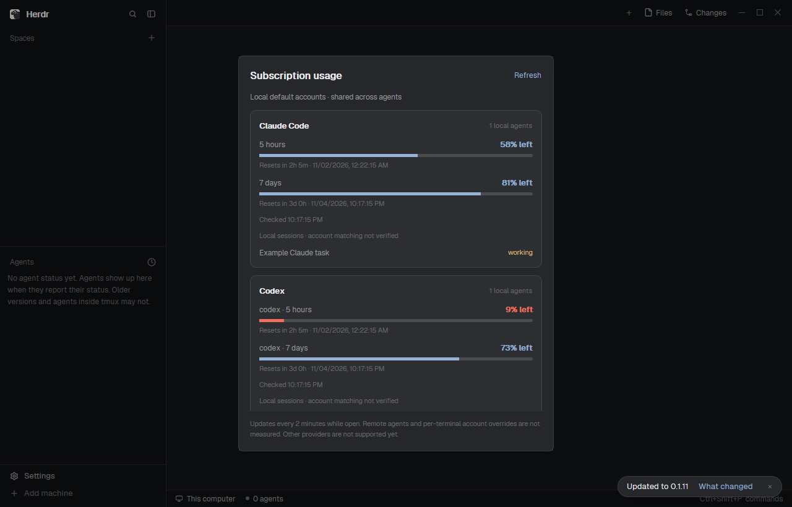

# Subscription usage

A personal dialog showing how much of the local default Claude Code and Codex
subscription allowance remains and when it resets, with links to local agent
sessions. All sessions using the same account share its quota.

## What you see

A 510 × 640 dialog, with 18px padding and 12px vertical gaps. The top row contains
a 16px semibold title and a Refresh action. A muted subtitle identifies default
accounts. A scrollable center holds two rounded provider cards, 14px padding,
with provider name and local session count. Each limit has a label, integer
percentage remaining, a 5px bar, relative and local absolute reset time, and last
check time. Ten percent or less uses the theme's blocked color. Unknown values
show a provider message; stale values use the dim color. Local sessions follow
with names and status. The footer describes refresh and account-matching limits.
Use Herdr theme colors throughout, including light themes.

## How it behaves

Refresh once on opening and every two minutes while open. Share a 30-second
manual cooldown across copies; do not overlap requests. A late result cannot
replace a newer result. Tick the UI every five seconds and retry a cancelled
query after its 35-second lock expires; completed queries retain two-minute
polling. Show errors as unavailable and label expired/old results
stale until another successful request. Never refill a quota merely because its
reset time passed. Clicking a session focuses its terminal and closes the dialog.
Working, blocked, done and idle sessions retain their status text and theme
color. Unknown status uses dim text. Remote/other-provider sessions are omitted.
The existing `mod.open` command and optional Ctrl+Shift+F8 toggle the dialog;
Escape closes it. No automatic menu or toolbar integration is assumed.

## Built from

One mod, `mods/subscription-usage`, with `place: none` and dialog overlay metadata.
No layout or shipped mod dependencies. It uses GPUI flex containers and Herdr
`agents`, `appHome`, `exec`, `theme`, `shared`, `setShared`, `run`, `props`, and
`closeOverlay` and `window`. `main.js` renders and calls the Node helper `query.mjs`; `quota.js`
normalizes results. The helper calls Anthropic's OAuth usage endpoint and starts
its own temporary `codex app-server` to read rate limits, never a model turn.
No third-party Node packages. `install.mjs` copies only runtime files to a new
folder, publishes `main.js` last, refuses collisions, and supports `--home` and
`--name`. The optional `keys.json` must be merged manually without replacing
existing keys. The installer does not launch programs or touch user settings.

## Watch out

Node 18+ and logged-in CLI subscriptions are required. Herdr's process environment
selects the CLI accounts; terminal environments are not read. Local sessions are
listed for navigation, not as proof that they use that account. The Claude usage
endpoint is not a stable public API; custom macOS keychain services are unsupported.
Do not log credentials/raw errors or refresh tokens. All displayed/cached data
is normalized; it persists in `shared.json`, not just memory. Malformed or absent
percentages are unknown, not zero used. Renaming the mod must update its helper
path and shortcut. Cross-mod relative imports are unavailable. Do not require
unmerged mod-button APIs. The standalone checker has no `window()` snapshot:
render without starting a query or persisting a busy lock in that context.
The screenshot contains synthetic data only.

## Done when

- `node --test install.test.mjs quota.test.mjs view.test.mjs` passes without
  network or real credentials.
- Installation into a scratch home preserves preexisting files and rejects a
  collision; a renamed install resolves its own helper.
- `herdr-app check <installed-folder>` reports no errors on a running isolated
  app, and `mod.open --name subscription-usage` opens the native dialog.
- Unknown, exhausted and stale windows remain distinct; session clicks focus
  only the specified local terminal.
- The actual dialog fits 510 × 640, scrolls long content and reflects light/dark
  theme colors. No live user app/core restart is required.
